# Labo 18

Zorg dat je de volgende folder structuur volgt:

```
webtechnologie/
├─ labo-01/
│  ├─ oefening-01/
│  │  ├─ index.html
│  │  ├─ images/
│  │  │  ├─ image-1.jpg
│  │  │  └─ image-n.jpg
│  │  ├─ css/
│  │  │   ├─ normalize.css
│  │  │   └─ style.css
│  │  └─ js/
│  │     └─ script.js
│  ├─ oefening-02/
│  └─ oefening-n/
├─ labo-02/
└─ labo-n/
```

- Gebruik steeds JS modules om globale variabelen te vermijden (`<script type="module" src="./path/to/script.js"></script>`)
- Volg de [Coding Guidelines](https://webtechnologie.programmeren-ap.be/coding-guidelines)

## Oefeningen events

### oefening 1: eerste event afhandelen

#### leerdoelen

* kennismaken met een event listener in JavaScript

#### functionele analyse

Reageer op een muisklik op een knop door een bericht in de console weer te geven.

#### technische analyse

In jouw HTML plaats je een button-element met een id, bijvoorbeeld "myAction" en wat tekst, bijvoorbeeld "Klik op mij".

In jouw JavaScript-code selecteer je deze button op basis van het id en voeg je er een event listener aan toe om te reageren op het "click"-event.

Wanneer de knop wordt geklikt, toon dan "er werd op mij geklikt" in de console.

#### voorbeeldinteractie
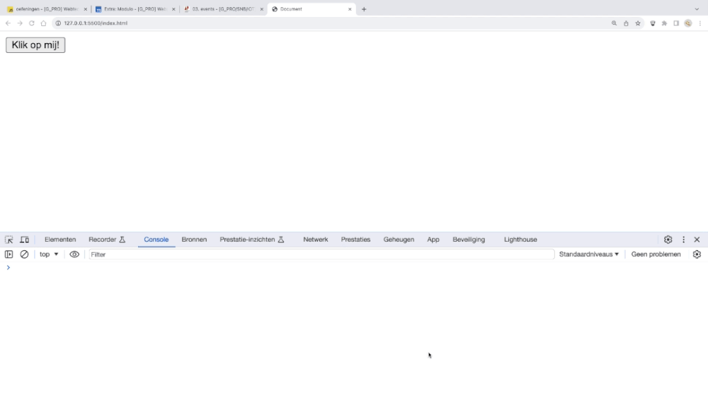

### oefening 2: reageren in DOM

#### leerdoelen

* kennismaken met een event listener in JavaScript
* DOM-manipulatie naar aanleiding van event

#### functionele analyse

Reageer op een muisklik op een knop door een bericht op de website weer te geven.

#### technische analyse

In jouw HTML plaats je een button-element met een id, bijvoorbeeld "myAction" en wat tekst, bijvoorbeeld "Klik op mij". Daaronder plaats je een p-element met een id, bijvoorbeeld "myText". Je laat de p nog leeg.

In jouw JavaScript-code selecteer je deze button op basis van het id en voeg je er een event listener aan toe om te reageren op het "click"-event.

Wanneer de knop wordt geklikt, toon dan "er werd op mij geklikt" in de p.

#### voorbeeldinteractie

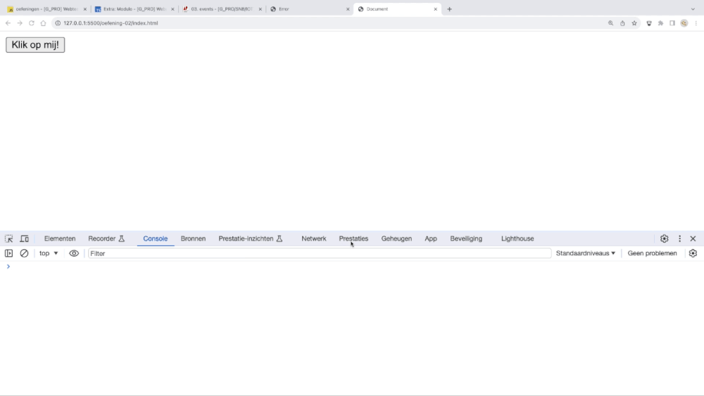

### oefening 3: reageren op form event

#### leerdoelen

* form event gebruiken
* default voorkomen

#### functionele analyse

Wanneer een gebruiker het formulier verzendt, toon je de naam van de gebruiker op het scherm.

#### technische analyse

Op jouw pagina staat een formulier met daarin 1 veld, nl. "voornaam".

Wanneer de gebruiker het veld heeft ingevuld (tip: required) en het formulier verzendt, zal jouw code voorkomen dat het formulier verzonden wordt.

Je toont de ingevulde naam van de gebruiker op het scherm in een welkomstboodschap.

#### voorbeeldinteractie

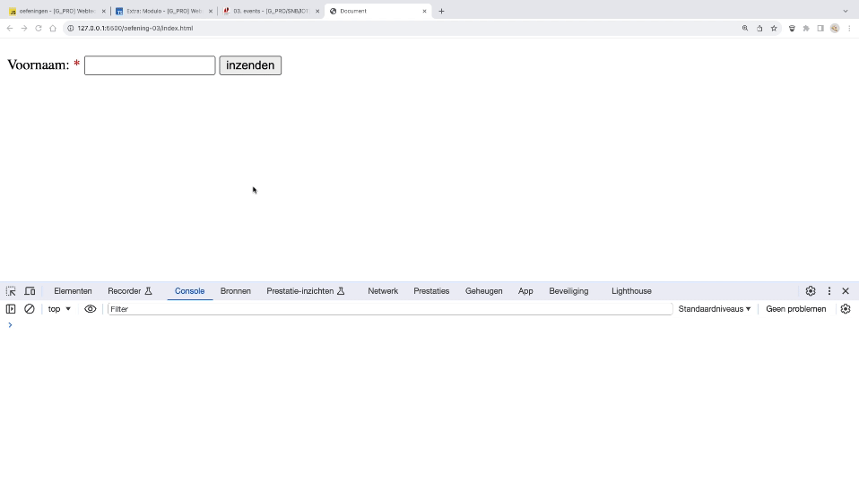

### oefening 4: reageren op invoer van gebruiker

#### leerdoelen

* keyboard event gebruiken

#### functionele analyse

Wanneer een gebruiker in een invoerveld typt, toon je de toetsaanslagen van de gebruiker op het scherm.

#### technische analyse

Op jouw pagina staat een invoerveld, nl. "input".

Wanneer de gebruiker iets invult, toon je de ingevulde tekst van de gebruiker op het scherm.

#### voorbeeldinteractie

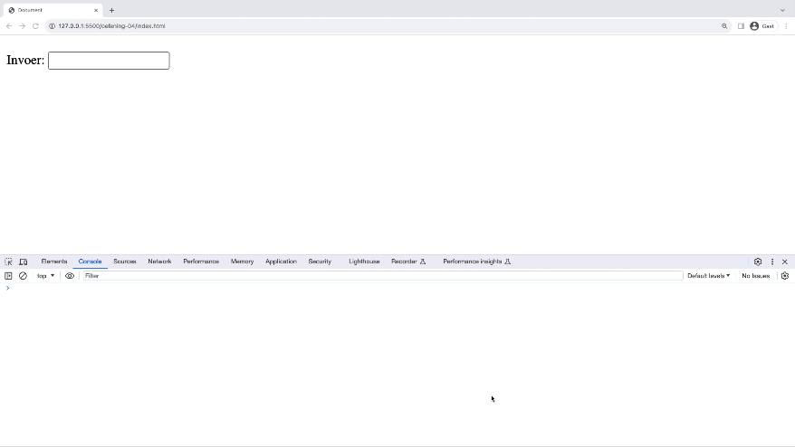

### oefening 5: reageren op muisbeweging

#### leerdoelen

* mouse event gebruiken

#### functionele analyse

Je geeft de positie van de muis weer op het scherm

#### technische analyse

Op jouw pagina staat een tekst, nl.: "Jouw muis bevindt zich op x: 150, y: 300".

Telkens de gebruiker zijn muis beweegt, toon je de nieuwe coördinaten in de tekst.

#### voorbeeldinteractie

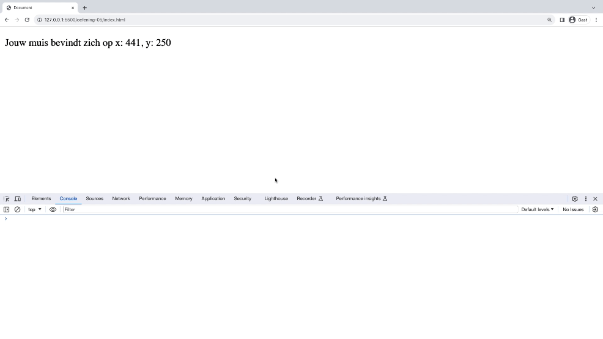

### oefening 6: DOM-element toevoegen door te klikken

#### leerdoelen

* DOM manipulatie
* click event

#### functionele analyse

Je voegt lijst-items toe door op een knop te drukken.

#### technische analyse

Jouw website bestaat uit een h1 "todo-lijst" en een oplijsten van enkele to-do's.

Er staat een knop onderaan de lijst. Als op deze knop geklikt wordt, zal er een to-do-item bijkomen op de lijst.

#### voorbeeldinteractie

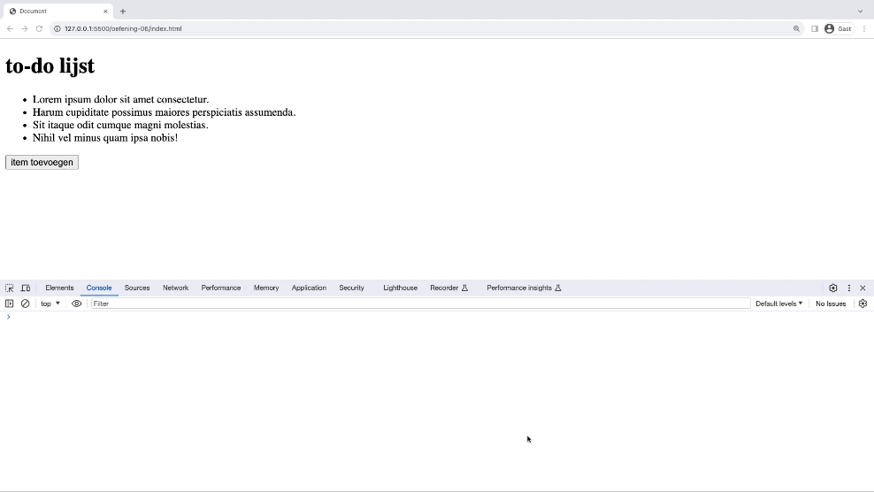

### oefening 7: raad de knop

#### leerdoelen

* dynamisch DOM-elementen aanmaken en toevoegen
* event listeners toevoegen aan dynamisch aangemaakte elementen
* willekeurige getallen genereren

#### functionele analyse

Er worden 100 knoppen op de pagina geplaatst. Precies 3 ervan zijn de "juiste" knoppen. De gebruiker moet proberen deze te vinden door erop te klikken. Klikken op een juiste knop markeert hem groen en geeft feedback. Klikken op een foute knop geeft een korte rode markering. Wanneer alle 3 juiste knoppen gevonden zijn, verschijnt er een bericht.

#### technische analyse

Bij het laden van de pagina voeg je via JavaScript 100 button-elementen toe aan het element met id `buttonGrid`. Kies willekeurig 3 unieke knoppen die de "juiste" zijn en log hun nummers naar de console.

Voeg aan elke knop een click-event listener toe. Wanneer geklikt:
- Is het een juiste knop: zet `disabled` op de knop, kleur hem groen, en update de statustekst (pas een class toe, bijvoorbeeld `found`, die de groene kleur en eventuele andere stijlen bevat).
- Is het een foute knop: zet `disabled` op de knop en kleur hem rood. (pas een class toe, bijvoorbeeld `miss`, die de rode kleur en eventuele andere stijlen bevat).

Wanneer alle 3 juiste knoppen gevonden zijn, toon je een felicitatiesbericht in het element met id `status`.

#### voorbeeldinteractie
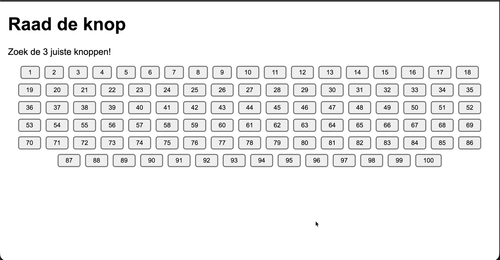

## Oefeningen events met startbestanden

- De nodige bestanden staan reeds klaar in deze repository (startbestanden-8-9)
- Kopieer deze voor elke oefening.
- In je browser zou je het volgende moeten zien als je de pagina opent: 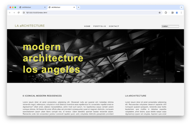

### oefening 8: formuliervalidatie

Je zal het formulier afhandelen in JavaScript.

#### functionele analyse

* Zorg dat een error-bericht wordt getoont wanneer een veld niet ingevuld is.
* Zorg dat een success-bericht wordt getoont wanneer alle velden juist ingevuld zijn met daarin de waardes van het name, email en message veld.

#### technische analyse

* Maak een bestand form.js.
* Koppel het bestand form.js aan de index.html.
* Geef het form-element een id en haal het op in je form.js met querySelector.
* Voeg een submit-eventlistener toe aan form.
* Haal de 3 velden op en kijk na of ze zijn ingevuld.
* niet ingevuld: geef een foutmelding
* ingevuld: geef een succesmelding
* Toon de ingevulde waarden aan de gebruiker via een `alert`.

#### voorbeeldinteractie

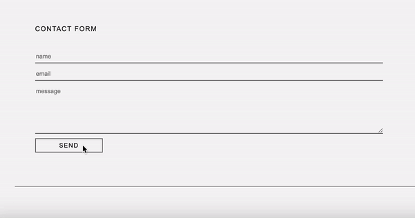

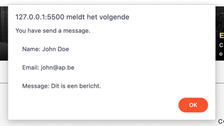

### oefening 9: frequently asked questions sectie (FAQ)

#### functionele analyse

* Maak een inklapbare FAQ met behulp van JavaScript.
* Voeg HTML toe zoals visueel weergegeven in de voorbeeldinteractie.
* Elk inklapbaar element bestaat uit:
* een button met class `collapsible`
* een p-element met class `context`

#### technische analyse

* Haal in faq.js alle elementen op met de klasse 'collapsible' en gebruik hierbij querySelectorAll.
* Loop over de array van elementen.
* Voeg voor elk element een 'click' eventlistener toe.
* Als er op een ingeklapt element wordt geklikt, wordt de inhoud zichtbaar.
* Als er op een opengeklapt element wordt geklikt, wordt de inhoud onzichtbaar.

#### voorbeeldinteractie

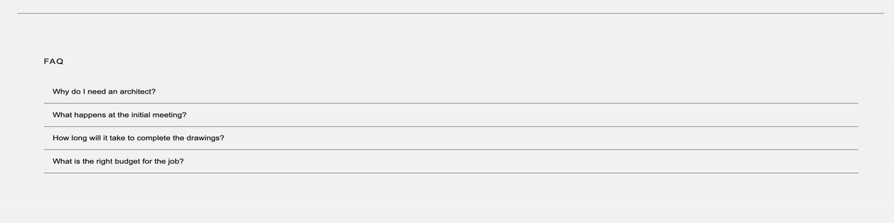

### oefening 10: modale dialoog

#### leerdoelen

* het `dialog`-element gebruiken
* een dialoog openen en sluiten met `showModal()` en `close()`
* de inhoud van een dialoog vullen vanuit JavaScript

#### functionele analyse

Op de pagina staat een knop **Bestelling bevestigen**. Een klik daarop opent een modale dialoog met een overzicht. De gebruiker kan de dialoog sluiten met een knop of met de Escape-toets.

#### technische analyse

* In jouw HTML plaats je een button met een id, bijvoorbeeld "openDialog".
* Daaronder plaats je een `dialog`-element met een id, bijvoorbeeld "orderDialog". In de dialoog staan een `h2` met de titel, een leeg `p`-element met een id (bijvoorbeeld "dialogTotal") en een knop om te sluiten.
* In jouw JavaScript selecteer je de knop en de dialoog met `querySelector`.
* Voeg aan de openknop een click-event listener toe die `showModal()` oproept op de dialoog. Zet vóór het openen ook een tekst in het lege `p`-element, bijvoorbeeld "Totaal: € 24,50".
* Voeg aan de sluitknop een click-event listener toe die `close()` oproept op de dialoog.
* Style de achtergrond van de dialoog met de pseudo-selector `dialog::backdrop`.

> Deze oefening bereidt je voor op de bevestigingsdialoog in deelopdracht 5 van de projectopdracht.

## Oefeningen event delegation

### oefening 11: boodschappenlijst met één listener

#### leerdoelen

* event delegation gebruiken: één listener op een parent-element
* het verschil tussen `event.target` en `event.currentTarget`
* bubbling stoppen met `stopPropagation()`

#### functionele analyse

Op de pagina staat een boodschappenlijst. Klik je op een item, dan wordt het doorstreept (en bij een tweede klik weer niet). Elk item heeft ook een knop "x" om het item te verwijderen. Onderaan staat een knop om een nieuw item toe te voegen. Ook de items die je nadien toevoegt reageren meteen op een klik, zonder dat je er een extra listener aan hangt.

#### technische analyse

In jouw HTML plaats je een `ul` met een id, bijvoorbeeld "shoppingList", met daarin enkele `li`-elementen. Elke `li` bevat de naam van het item en een `button` met de tekst "x". Onder de lijst plaats je een button met een id, bijvoorbeeld "addItem".

In jouw JavaScript hang je **één** click-event listener op de `ul`, niet op elke `li` apart. Dat kan omdat een click op een `li` doorbubbelt naar de `ul`.

In de handler gebruik je:
- `event.currentTarget`: altijd de `ul`, want daar staat de listener op.
- `event.target`: het element waarop echt geklikt werd, dus de `li` of de "x"-button.

Log beide eens naar de console zodat je het verschil ziet.

Is het target een `li`? Toggle dan een class, bijvoorbeeld `done`, die `text-decoration: line-through` zet. Tip: `event.target.tagName` geeft de naam van het element terug in hoofdletters.

Het verwijderen regel je niet in die gedelegeerde listener, maar in een eigen click-listener op elke "x"-button. Die listener verwijdert de `li` waarin de button zit (gebruik `event.target.closest('li')`) en roept daarna `event.stopPropagation()` op, zodat de klik niet verder bubbelt naar de `ul`. Probeer eerst eens zonder `stopPropagation()`: dan loopt de handler op de `ul` ook nog en wordt de class nog toegevoegd aan een item dat al verwijderd is.

De knop "nieuw item" voegt een `li` toe aan de lijst. Merk op dat je daar geen enkele listener aan moet toevoegen: de listener op de `ul` vangt de klik ook voor nieuwe items op. Dat is precies de winst van event delegation.

#### voorbeeldinteractie

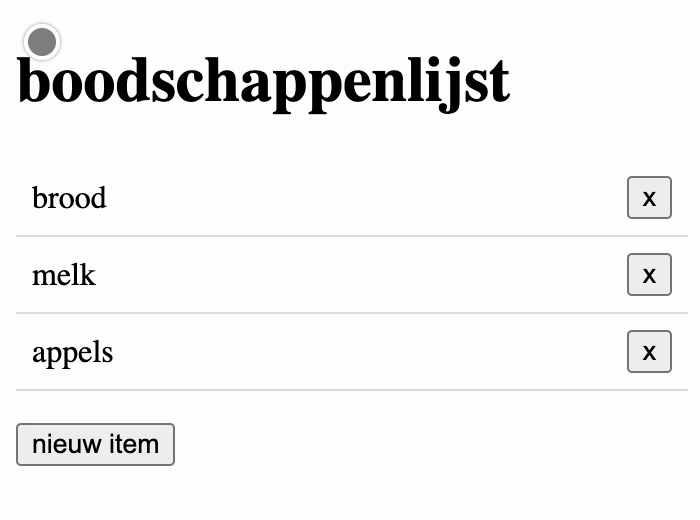

### oefening 12: pizza samenstellen

#### leerdoelen

* het `change`-event gebruiken
* `event.target.checked` uitlezen
* event delegation op een formulier

#### functionele analyse

De gebruiker stelt een pizza samen door toppings aan te vinken. Bij elke wijziging zie je meteen de lijst van gekozen toppings en de totaalprijs. Vink je een topping weer uit, dan verdwijnt hij uit de lijst en daalt de prijs.

#### technische analyse

In jouw HTML plaats je een `form` met een id, bijvoorbeeld "pizzaForm". Daarin staan enkele checkboxes, elk met een `value` (de naam van de topping) en een `data-price`-attribuut met de prijs, bijvoorbeeld:

```html
<label>
  <input type="checkbox" value="mozzarella" data-price="2.50"> mozzarella (€ 2,50)
</label>
```

Onder het formulier plaats je een `p` of `ul` voor de gekozen toppings en een `p` met een id voor het totaal.

In jouw JavaScript hang je **één** `change`-event listener op het formulier. Het `change`-event van een checkbox bubbelt, dus je hoeft geen listener per checkbox te zetten.

In de handler:
- Lees `event.target.checked` uit om te weten of de topping aan- of afgevinkt werd. Log dit naar de console.
- Haal daarna alle aangevinkte checkboxes op met `form.querySelectorAll('input[type="checkbox"]:checked')`.
- Toon de `value` van elke aangevinkte topping op het scherm.
- Tel de prijzen op. De prijs haal je uit het dataset-attribuut: `Number(checkbox.dataset.price)`.
- Toon het totaal met 2 cijfers na de komma (tip: `toFixed(2)`).

Is er niets aangevinkt? Toon dan "nog geen toppings gekozen" en een totaal van € 0,00.

#### voorbeeldinteractie

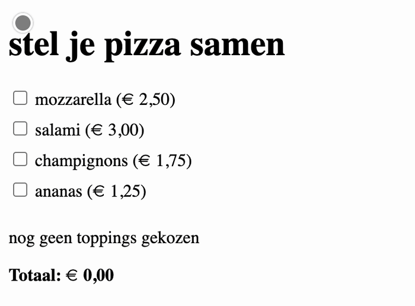
